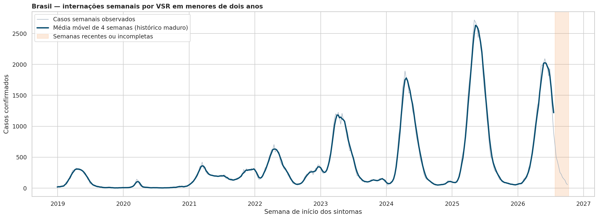
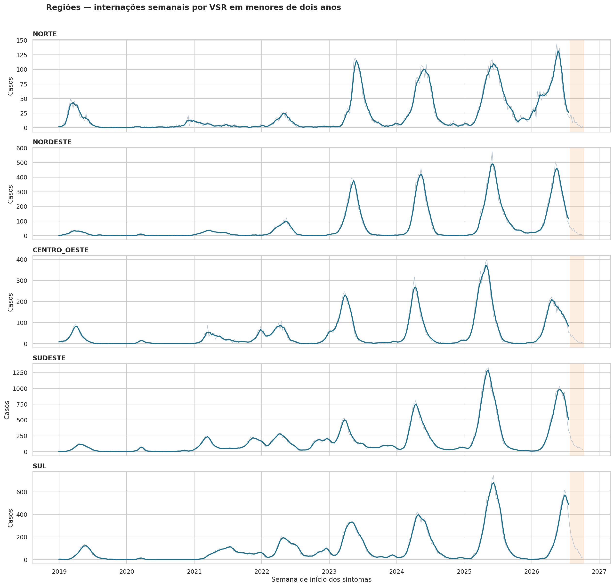
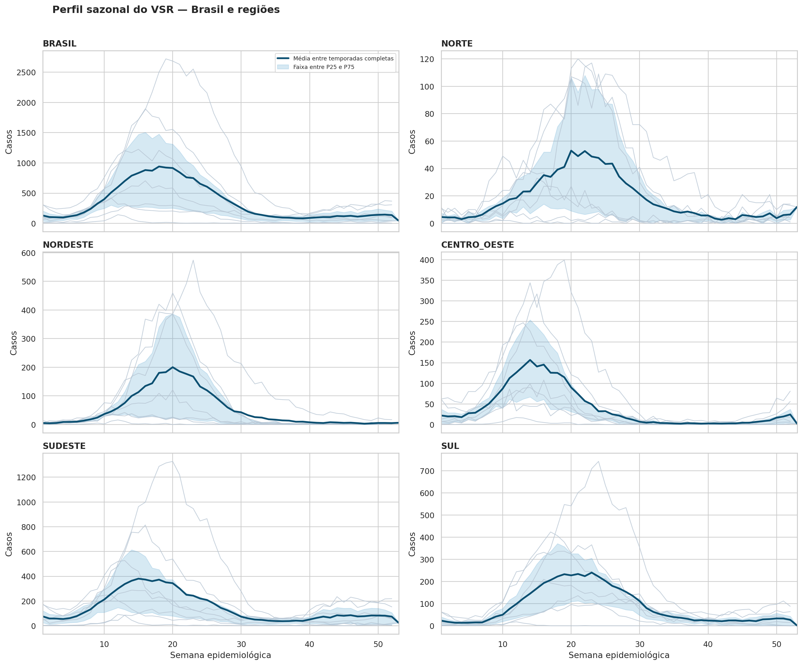
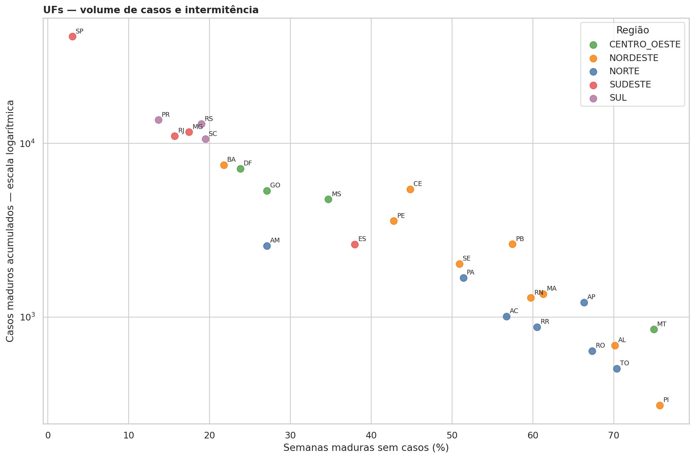
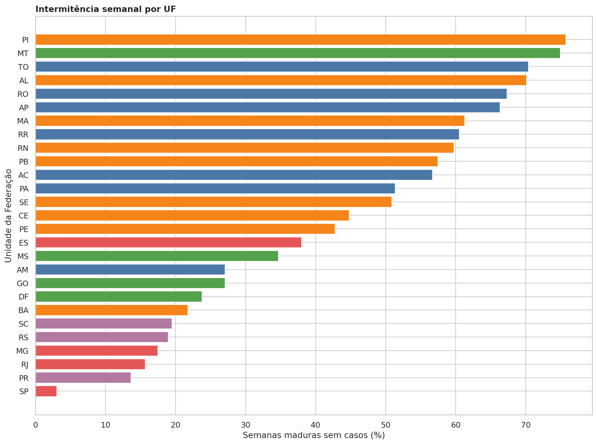
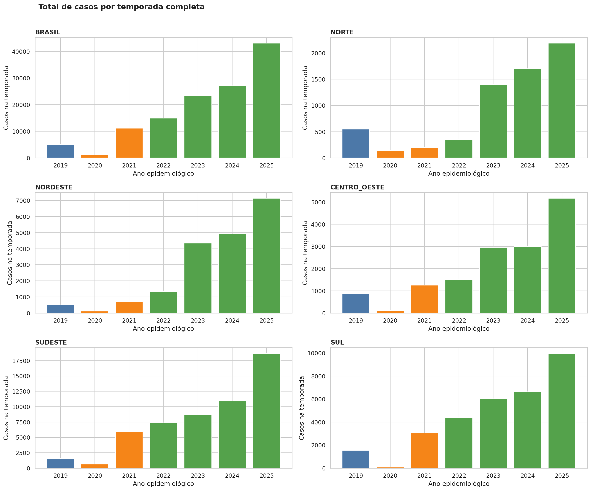
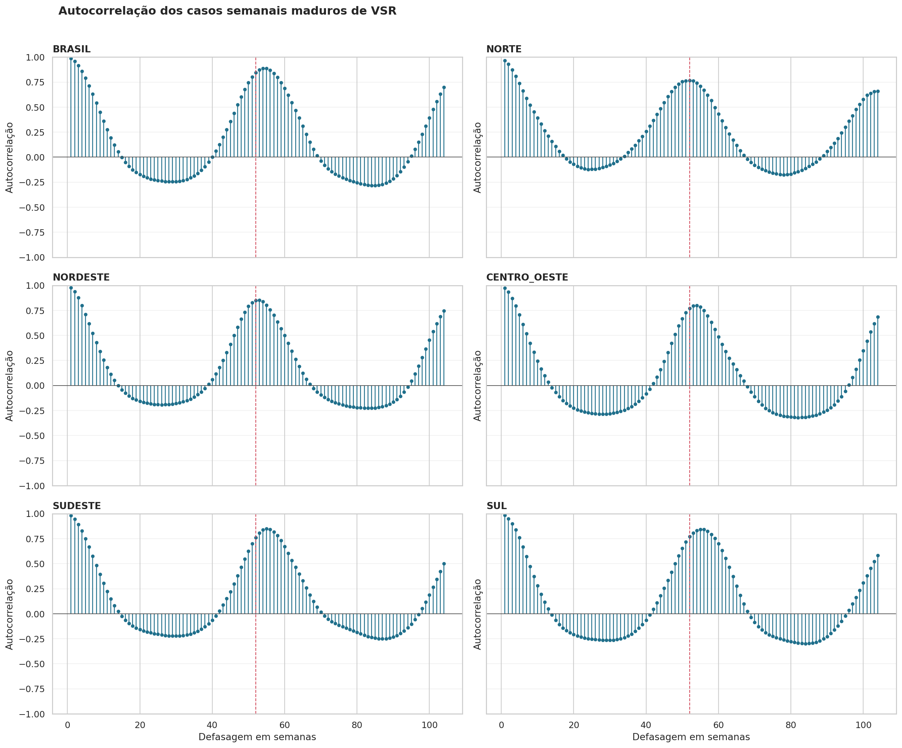
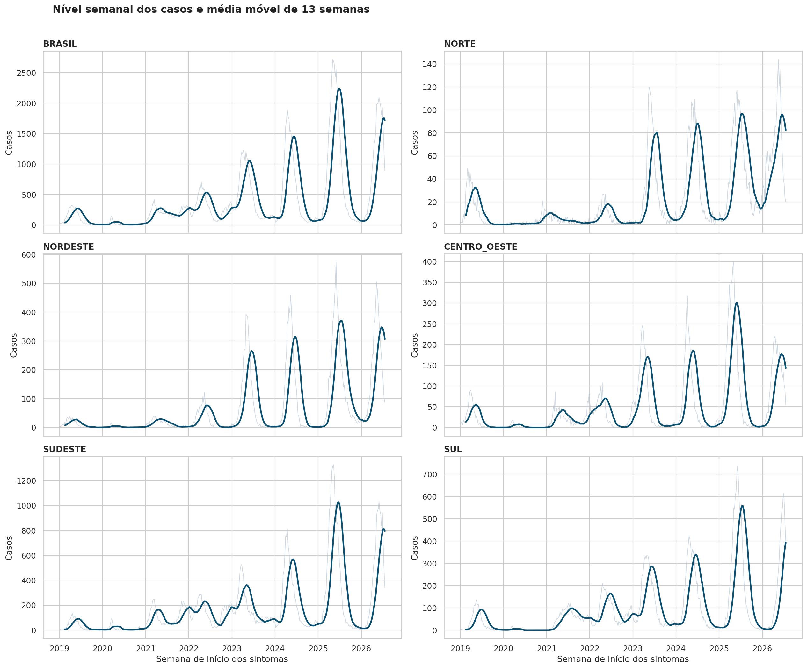
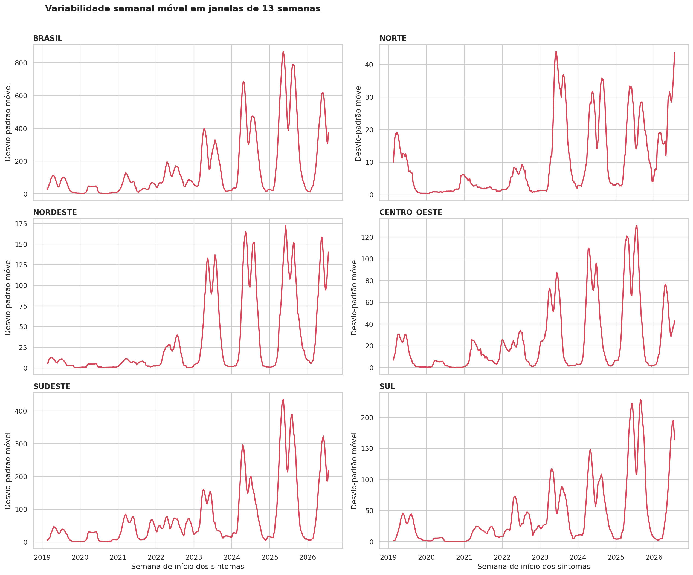
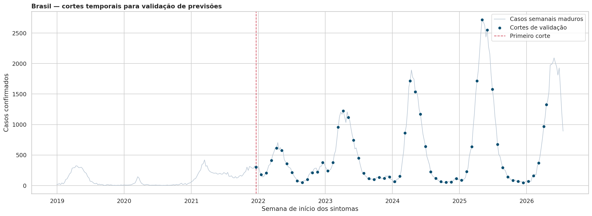

# Decisões da análise exploratória — V2

## Objetivo desta etapa
Esta etapa busca entender o comportamento das séries semanais de internações por VSR antes de testar modelos de previsão.
O objetivo não é provar causalidade nem escolher o melhor modelo ainda; é descobrir quais características dos dados os modelos precisarão respeitar.
Foram usadas prioritariamente as 395 semanas maduras, porque as 12 semanas mais recentes ainda podem receber notificações e resultados laboratoriais.

## Base usada
- Painel semanal produzido no tratamento de dados: 27 UFs, 5 regiões e Brasil.
- Período do painel: 30/12/2018 a 11/10/2026, totalizando 407 semanas.
- Período histórico maduro usado nas estatísticas: até 19/07/2026.
- Unidade analisada: número semanal de internações confirmadas por VSR em menores de dois anos.

## Etapa 12 — Carregamento e validação da entrada
**Por que esta etapa veio antes dos gráficos?** Um gráfico pode parecer correto mesmo quando a base contém linhas duplicadas, semanas faltantes ou unidades geográficas inesperadas. Primeiro foi necessário validar o objeto que alimentaria toda a análise exploratória.

**O que foi verificado.** O script conferiu a chave `nível + unidade + semana`, os níveis geográficos, a quantidade de UFs, regiões, semanas e o número de semanas maduras.

**Resultado.** O painel tem 13.431 linhas, zero duplicidades, 27 UFs, 5 regiões, Brasil e 395 semanas maduras para o nível nacional.

**Decisão.** A entrada foi aprovada para EDA. Não foram usados gráficos nesta etapa porque o objetivo era controle de qualidade, e não interpretação visual.

## Etapa 13 — Séries temporais do Brasil e das regiões
**Por que usar gráficos de linha?** A série temporal precisa ser vista na ordem em que os eventos ocorreram. Gráficos de linha mostram picos, quedas, mudanças de nível e diferenças de formato entre regiões; uma tabela de médias não mostraria esses padrões.

**Como o script foi construído.** As linhas claras representam os casos semanais observados. A linha azul escura é uma média móvel centrada de quatro semanas, usada apenas para facilitar a leitura visual. A faixa laranja identifica semanas recentes ou incompletas.

**Cuidado importante.** A média móvel centrada usa observações posteriores à semana analisada. Por isso ela é aceitável para descrição histórica, mas não poderá ser usada como variável de previsão.

**Leitura do Brasil.** A série mostra picos anuais claros, aumento dos valores observados após 2022 e uma queda acentuada fora da temporada. A média semanal madura foi 393 casos, enquanto a mediana foi 177; essa diferença mostra que poucas semanas de pico elevam muito a média.

**Leitura das regiões.** O Sudeste concentrou 42,9% dos casos maduros, seguido por Sul (24,0%), Nordeste (16,0%), Centro-Oeste (11,7%) e Norte (5,5%). Cada painel usa escala própria: isso facilita enxergar o formato temporal local, mas a comparação de volume deve ser feita pelos números, não pela altura visual das curvas.

**Decisão.** Brasil e regiões têm sinal temporal suficiente para análises de sazonalidade. Os anos de 2020 e 2021 permanecem no histórico, mas serão tratados como períodos atípicos em análises posteriores, pois não têm o mesmo comportamento dos anos mais recentes.

## Etapa 14 — Sazonalidade e picos anuais
**Por que esta análise foi necessária?** O gráfico cronológico indica repetição, mas não responde com precisão se o aumento ocorre nas mesmas semanas do ano. Para isso, comparamos cada semana epidemiológica entre temporadas.

**Por que não incluir 2026 no perfil sazonal?** Em 2026 existem somente 30 semanas maduras. Incluir uma temporada incompleta reduziria artificialmente as médias das semanas posteriores e distorceria o perfil sazonal.

**Como o script foi construído.** Linhas claras representam temporadas completas de 2019 a 2025. A linha azul escura é a média dessas temporadas. A área sombreada mostra a faixa entre os percentis 25 e 75: quanto mais larga, maior a variação entre anos.

**Achados.** O Brasil teve picos entre as semanas epidemiológicas 11 e 19, aproximadamente de março a maio. Sudeste e Centro-Oeste apresentaram padrão mais precoce e concentrado. Nordeste teve picos mais tardios nos anos recentes, chegando à semana 23 em 2025. Norte e Sul apresentaram maior variação de semana de pico.

**Limite da medida de pico.** Nesta etapa, o pico é a maior contagem semanal bruta. Mais adiante, será calculado também um pico suavizado, pois uma oscilação isolada pode deslocar a semana de máximo.

**Decisão.** Há sazonalidade relevante, mas ela não é idêntica em todas as regiões. Portanto, um único calendário nacional fixo é insuficiente para representar todas as unidades.

## Etapa 15 — Intermitência e dispersão das UFs
**Por que não analisar somente regiões?** A agregação regional reduz ruído, mas pode esconder UFs que têm poucos casos e muitos zeros. Esses casos exigem métodos e comparações diferentes dos usados para séries densas.

**Como o script foi construído.** Para cada UF, foram calculados total de casos, média, mediana, variância, desvio-padrão, percentil 95, pico e percentual de semanas maduras sem casos. Também foi calculado o índice de dispersão, isto é, variância dividida pela média.

**Leitura do gráfico de dispersão.** O eixo vertical está em escala logarítmica porque o total de casos varia muito entre UFs. São Paulo tem grande volume e apenas 3,0% de semanas com zero; Piauí tem 310 casos acumulados e 75,7% de semanas sem caso. Sem escala logarítmica, as UFs de menor volume ficariam visualmente escondidas.

**Achados.** Treze UFs têm mais de 50% das semanas maduras sem casos. Piauí, Mato Grosso, Tocantins e Alagoas superam 70%. Todas as UFs têm índice de dispersão maior que 1, sinal de variabilidade maior do que uma contagem estável simples.

**Decisão.** Não será razoável presumir que um único modelo local tenha o mesmo desempenho em todas as UFs. Séries densas, como São Paulo, Minas Gerais, Paraná, Rio Grande do Sul e Rio de Janeiro, podem sustentar modelos locais. Séries muito esparsas deverão ser comparadas também com referências simples e, posteriormente, com abordagens globais ou hierárquicas.

## Etapa 16 — Comparação entre temporadas e períodos
**Por que esta comparação foi necessária?** A sazonalidade mostra quando os picos ocorrem, mas não informa se a magnitude das temporadas permaneceu estável. Por isso, foram comparados totais, médias semanais e picos de cada temporada epidemiológica completa, de 2019 a 2025.

**Como o script foi construído.** Foram incluídas apenas temporadas com pelo menos 52 semanas maduras. O ano de 2026 foi excluído das estatísticas porque ainda está incompleto. Os anos foram organizados de forma descritiva em pré-pandemia (2019), pandemia (2020–2021) e pós-pandemia (2022–2025); esses rótulos não representam uma atribuição causal.

**Achados.** No Brasil, o total caiu para 1.120 casos em 2020, subiu para 11.124 em 2021 e cresceu de 14.969 em 2022 para 43.152 em 2025. O aumento posterior aparece em todas as regiões. A comparação deve priorizar também a média semanal, pois 2020 possui 53 semanas epidemiológicas, enquanto os demais anos têm usualmente 52.

**Limite importante.** Os anos de 2020 e 2021 foram muito diferentes entre si; portanto, a média dos dois não deve ser tratada como um único comportamento representativo de “pandemia”. Mudanças em testagem, notificação e vigilância também podem contribuir para diferenças observadas. O resultado descreve os registros da base e não identifica uma causa única.

**Decisão.** As mudanças de nível entre anos precisam ser consideradas nas avaliações futuras. A comparação dos modelos será feita por validação temporal, preservando a ordem histórica, em vez de supor que todas as temporadas foram geradas pelo mesmo processo estável.

## Etapa 17 — Dependência temporal e autocorrelação
**Por que medir autocorrelação?** Uma série de previsão não é composta por semanas independentes. A autocorrelação mede o quanto os casos de uma semana se relacionam com os de semanas anteriores e permite quantificar a persistência de curto prazo e a repetição anual sugerida pelos gráficos anteriores.

**Como o script foi construído.** Foram analisadas as 395 semanas maduras do Brasil e das cinco regiões. O script conferiu duplicidades, valores ausentes, presença das seis unidades esperadas e continuidade de sete dias entre semanas. Em seguida, calculou autocorrelações para defasagens de 1 a 104 semanas.

**Achados.** A autocorrelação de uma semana foi muito alta: 0,987 no Brasil e entre 0,965 e 0,983 nas regiões. Nas defasagens de 52 e 53 semanas, os valores permaneceram altos — 0,845 e 0,874 no Brasil, respectivamente — confirmando repetição anual relevante. Por volta de 26 semanas, as correlações são negativas, coerentes com a oposição entre períodos de pico e de baixa incidência dentro do ano.

**Cuidado na leitura.** A autocorrelação foi calculada na série bruta. Assim, ela reflete sazonalidade, mas também mudanças de nível e de amplitude entre anos. Ela não prova estacionariedade e não é, por si só, um critério para escolher modelo. Testes e diagnósticos de resíduos serão feitos somente após o ajuste dos modelos.

**Decisão.** As referências e os modelos posteriores devem considerar defasagens curtas e o ciclo anual. A repetição não é perfeitamente fixa: os maiores valores anuais em algumas séries ocorrem entre 53 e 56 semanas, o que reforça a necessidade de comparar modelos em dados temporais reais, e não assumir uma sazonalidade idêntica todos os anos.

## Etapa 18 — Evolução do nível e da variabilidade
**Por que analisar nível e variabilidade juntos?** Uma série de contagens pode apresentar oscilações maiores exatamente nos períodos de maior número de casos. Isso afeta a adequação de transformações e de modelos que pressupõem variância constante. Por isso, o nível e o desvio-padrão foram observados ao longo do tempo.

**Como o script foi construído.** A tabela resume, para cada temporada completa, média, mediana, desvio-padrão, variância, percentis e coeficiente de variação. Os gráficos usam todas as semanas maduras, incluindo a parte disponível de 2026, com janelas móveis retrospectivas de 13 semanas. Essas linhas móveis servem para descrição visual e não serão usadas como informação futura em previsões.

**Achados.** O Brasil passou de média semanal de 287,9 casos em 2022 para 829,8 em 2025; no mesmo intervalo, o desvio-padrão semanal subiu de 173,7 para 912,3. O padrão de maior variabilidade durante as ondas sazonais aparece em todas as regiões. Em 2025, por exemplo, o Sudeste teve média de 359,3 e desvio-padrão de 428,4, enquanto o Nordeste teve média de 137,3 e desvio-padrão de 154,8.

**Limite importante.** Crescimento simultâneo de média e desvio-padrão sugere heterocedasticidade, mas não a demonstra formalmente nem determina automaticamente que uma transformação é necessária. Séries de contagem também têm variabilidade associada à própria magnitude e à sazonalidade.

**Decisão.** Na etapa de modelagem, serão comparadas especificações na escala original e transformações apropriadas para contagens, quando aplicáveis. Todas as previsões serão avaliadas na escala original de casos, para que os erros mantenham interpretação operacional em número de internações.

## Etapa 19 — Calendário de validação temporal
**Por que definir o calendário antes dos modelos?** Uma previsão só é avaliada de forma honesta quando o modelo usa exclusivamente as informações que estariam disponíveis no momento em que a previsão seria emitida. Separar treino e teste aleatoriamente violaria a ordem temporal e permitiria que o futuro influenciasse o passado.

**Como o script foi construído.** Foram usadas as séries maduras de Brasil e regiões, depois de confirmar ausência de duplicidades, valores ausentes e lacunas semanais. Cada corte começa com pelo menos 156 semanas de treino, equivalentes a aproximadamente três anos. Foram criados novos cortes a cada quatro semanas e incluído o último corte possível; em cada um, serão avaliados horizontes de 1, 4, 8 e 13 semanas.

**Resultado.** Cada uma das seis séries possui 58 cortes de validação para cada horizonte, totalizando 58 previsões por combinação de série e horizonte. O primeiro corte ocorre em 19/12/2021, com 156 semanas de histórico. O último corte ocorre em 19/04/2026, permitindo observar o resultado de uma previsão de 13 semanas em 19/07/2026, última semana madura disponível.

**Por que esses horizontes?** Uma semana representa uma necessidade imediata de acompanhamento. Quatro semanas aproximam um mês, oito semanas aproximam dois meses e 13 semanas representam aproximadamente um trimestre. Avaliar todos evita concluir que um modelo bom para curto prazo será necessariamente bom para planejamento com antecedência maior.

**Decisão.** A comparação de todos os modelos seguirá exatamente este calendário expansivo. Em cada corte, o conjunto de treino crescerá com a chegada de novas semanas, mas nenhuma informação posterior à data de origem poderá ser usada para ajustar ou escolher previsões. As métricas serão calculadas separadamente por horizonte.

## Conclusões provisórias para a modelagem
1. A previsão deve preservar a frequência semanal e a diferença entre UFs, regiões e Brasil.
2. A sazonalidade anual é forte, mas varia em intensidade e timing entre regiões.
3. Semanas recentes não podem ser tratadas como observações finais sem considerar atraso de disponibilidade.
4. Brasil e regiões têm séries densas; várias UFs possuem muitos zeros e alta dispersão.
5. Há dependência forte de curto prazo e repetição anual, mas o nível e a variabilidade mudam entre temporadas.
6. A avaliação será temporal, expansiva e separada por horizontes de 1, 4, 8 e 13 semanas.
7. Os modelos serão avaliados contra referências sazonais simples, e não apenas comparados entre si.

## Próximos passos da EDA
Com a estrutura dos dados, a exploração e o calendário de validação definidos, a próxima etapa será estabelecer referências sazonais simples. Depois disso começará o ajuste e a comparação formal dos modelos.

## Arquivos de evidência
- Notebook da EDA: `notebook_parcial_analise_exploratoria.ipynb/`.
- Resultados numéricos e gráficos: `resultados_scripts/`.
- Entrada validada: `controle_entrada_eda.csv` e `perfil_unidades_eda.csv`.
- Sazonalidade: `perfil_sazonal_brasil_regioes.csv`, `picos_anuais_brasil_regioes.csv` e `completude_temporadas_eda.csv`.
- Intermitência: `perfil_ufs_intermitencia.csv`.
- Temporadas: `resumo_temporadas_brasil_regioes.csv` e `comparacao_periodos_brasil_regioes.csv`.
- Dependência temporal: `autocorrelacoes_brasil_regioes.csv` e `resumo_autocorrelacao_brasil_regioes.csv`.
- Nível e variabilidade: `resumo_variabilidade_temporadas_brasil_regioes.csv`.
- Validação temporal: `calendario_validacao_temporal.csv` e `resumo_validacao_temporal.csv`.
