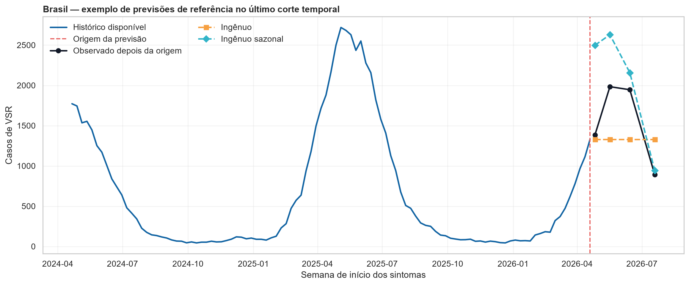
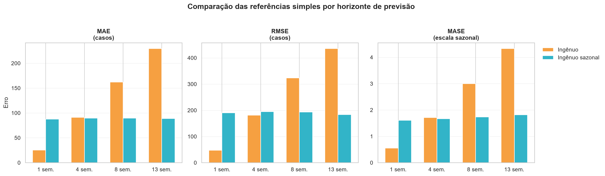
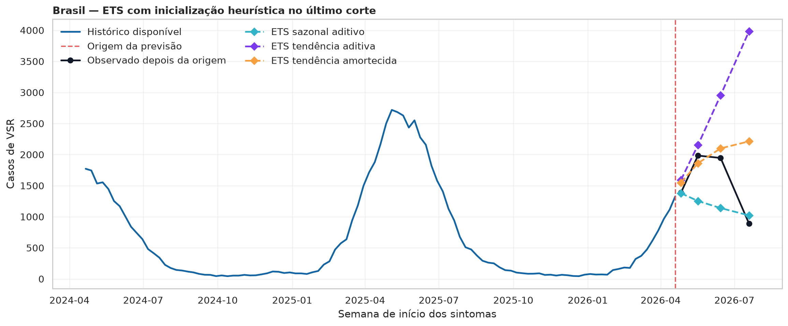
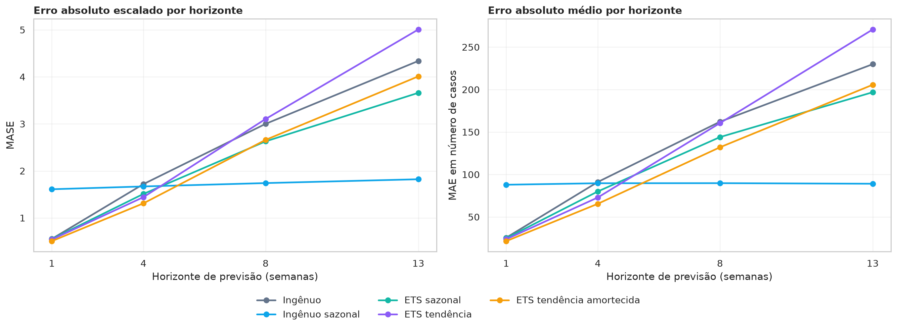
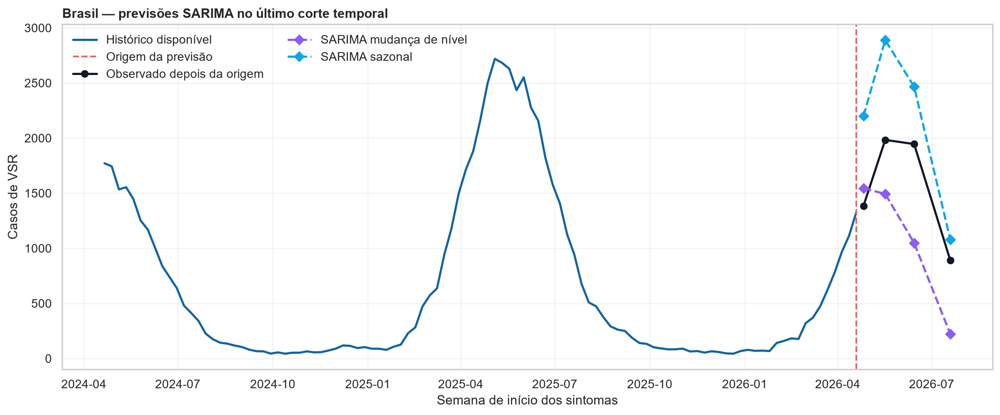
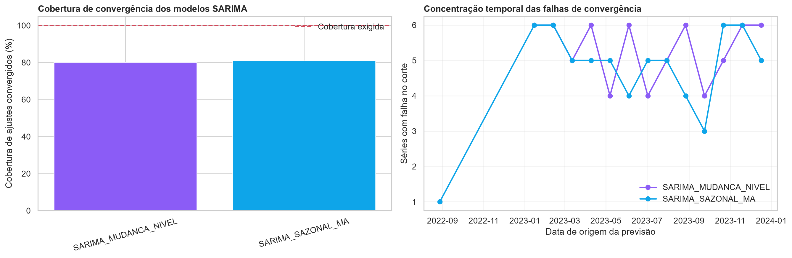
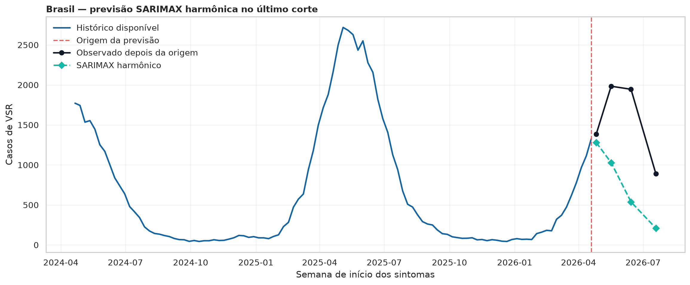
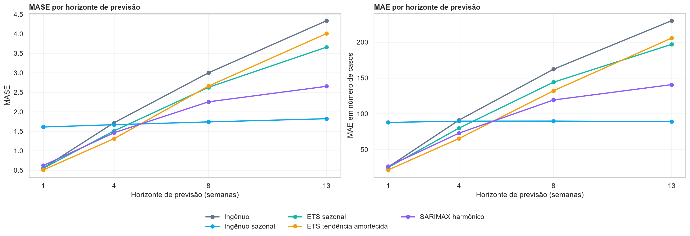
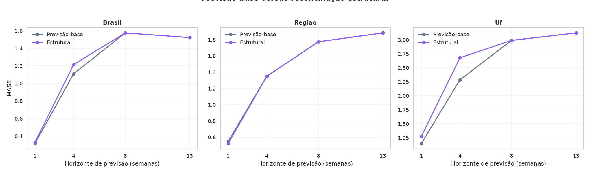

# Decisões da modelagem e avaliação de previsões — V2

## Objetivo desta etapa

Esta etapa transforma o painel semanal maduro e os achados exploratórios em previsões avaliadas fora da amostra. O objetivo não é escolher o modelo mais complexo: é identificar previsões úteis para antecipar internações por VSR, com comparação justa, reprodutível e compatível com a estrutura geográfica dos dados.

Inicialmente, a avaliação foi feita para Brasil e cinco regiões, que possuem séries mais densas. Em seguida, a estrutura foi ampliada para as 27 Unidades da Federação (UFs), sem ignorar a intermitência de parte delas. Assim, a modelagem passa a responder a duas perguntas diferentes: qual modelo prevê melhor cada horizonte e como tornar previsões de UF, região e Brasil coerentes entre si.

## Reprodução local e princípios de validação

Os resultados documentados abaixo foram reproduzidos localmente em 08/11/2026, no diretório de execução separado do repositório: `/home/thiago/Series-Temporais-Trabalho/execucao_local_vsr`. A separação preserva o projeto versionado e, ao mesmo tempo, permite guardar os arquivos intermediários, auditorias e resultados pesados sem depender de créditos ou do armazenamento temporário do Colab.

O ambiente local utilizou Python 3.13.18, pandas 3.1.1, pyarrow 26.0.1 e statsmodels 0.15.0. Os mesmos microdados congelados, a mesma regra de maturidade de 13 semanas e o mesmo calendário temporal foram usados em todos os modelos comparados.

Os princípios adotados são os seguintes:

1. Cada previsão usa somente informações disponíveis até sua data de origem.
2. Todos os modelos de uma comparação recebem o mesmo painel, os mesmos cortes e os mesmos horizontes.
3. A cobertura é requisito para entrar no ranking: não é adequado declarar vencedor um modelo avaliado em menos cortes que os demais.
4. MAE e RMSE permanecem em número de casos; MASE permite comparar Brasil e regiões, que têm escalas muito distintas.
5. Convergência, previsões negativas, viés e coerência territorial são diagnósticos tão importantes quanto o erro médio.
6. A escolha pode variar por horizonte. Não há justificativa para exigir que um único modelo seja o melhor para uma, quatro, oito e treze semanas.

## Entrada adotada

- Painel de origem: `painel_vsr_semanal_com_maturidade.parquet`.
- Unidade prevista: número semanal de internações por SRAG associadas ao VSR em crianças menores de dois anos.
- Período maduro: 30/12/2018 a 19/07/2026.
- Séries inicialmente modeladas: Brasil e cinco regiões.
- Comprimento de cada série densa: 395 semanas maduras.
- Calendário temporal: 58 origens por série e horizontes de 1, 4, 8 e 13 semanas.

Em cada modelo não hierárquico, isso corresponde a 6 séries × 58 origens × 4 horizontes = 1.392 previsões. Esse número será usado como referência de cobertura.

## Etapa 20 — Preparação das entradas para previsão

Esta etapa confirmou que o painel e o calendário de validação realmente representam o mesmo problema de previsão. O painel completo possui linhas recentes ainda não maduras; elas foram preservadas, mas não foram transformadas em zeros nem usadas no treino ou na avaliação. Isso evita tratar atraso de notificação como ausência de casos.

O recorte aprovado contém 2.370 linhas: seis séries e 395 semanas maduras por série. Não há duplicidade na chave `nível + unidade + semana`, casos negativos ou valores ausentes de `casos_vsr` no recorte de modelagem. O Brasil totaliza 155.304 casos maduros, exatamente a soma das cinco regiões.

Também foram verificados os 1.392 alvos do calendário. Todos estão presentes no painel maduro, possuem o indicador de maturidade verdadeiro e coincidem exatamente com o valor observado associado a cada data-alvo.

**Decisão.** A entrada foi aprovada para baselines e modelos. As UFs não foram excluídas; foram reservadas para a etapa hierárquica, onde sua intermitência poderá ser tratada explicitamente.

## Etapa 21 — Referências simples de previsão

As referências simples estabelecem o desempenho mínimo que um modelo mais complexo precisa superar. A referência ingênua repete o último valor conhecido na origem e representa persistência de curtíssimo prazo. A referência ingênua sazonal recupera a observação da mesma semana epidemiológica do ano anterior.

O método sazonal usou `ano_epi` e `semana_epi`, em vez de simplesmente subtrair 52 semanas. Essa escolha evita desalinhamentos em anos epidemiológicos com 53 semanas. A auditoria confirmou que nenhuma referência sazonal usou informação posterior à origem e que as duas referências produziram as 1.392 previsões esperadas.

No último corte nacional, a referência ingênua repetiu 1.328 casos em todos os horizontes. A referência sazonal recuperou o perfil da temporada anterior e previu 2.499, 2.629, 2.158 e 942 casos para 1, 4, 8 e 13 semanas. Os observados foram 1.386, 1.984, 1.946 e 892. O exemplo não decide o vencedor, mas mostra por que persistência e sazonalidade carregam informações diferentes.

**Decisão.** As referências ingênua e ingênua sazonal foram aprovadas como baselines oficiais do estudo.

## Etapa 22 — Métricas das referências

MAE expressa o erro absoluto médio em casos. RMSE dá mais peso a erros grandes, especialmente importantes quando há risco de pressão hospitalar. MASE divide o erro por uma escala sazonal calculada dentro do treino de cada origem, tornando possível comparar Brasil e regiões sem que a escala da série nacional domine a análise.

Foram calculadas 348 escalas MASE — uma para cada combinação de série e origem — sempre usando somente semanas disponíveis até aquela data. Todas foram positivas e válidas.

| Horizonte | Ingênuo: MASE | Sazonal: MASE | Melhor referência |
|---|---:|---:|---|
| 1 semana | 0,554 | 1,610 | Ingênuo |
| 4 semanas | 1,720 | 1,670 | Sazonal |
| 8 semanas | 3,001 | 1,741 | Sazonal |
| 13 semanas | 4,338 | 1,823 | Sazonal |

O MAE ingênuo cresce de 25,6 casos em uma semana para 229,9 em 13 semanas. O MAE sazonal é maior em uma semana, 87,9, mas permanece próximo de 90 casos de quatro a 13 semanas. A leitura é epidemiologicamente coerente: repetir o último nível pode ser suficiente para resposta imediata, mas não acompanha bem uma onda inteira de circulação do VSR.

**Decisão.** Modelos posteriores precisam superar o ingênuo em uma semana e, principalmente, o ingênuo sazonal em oito e 13 semanas.

## Etapa 23 — Tentativa ETS inicial

O primeiro experimento ETS comparou estruturas com sazonalidade anual: ETS sazonal aditivo, ETS com tendência aditiva e ETS com tendência aditiva amortecida. A ideia era representar nível, possível tendência recente e o padrão anual de VSR.

A primeira implementação estimava simultaneamente os estados sazonais iniciais, nível e tendência. Esse procedimento mostrou instabilidade numérica em alguns cortes, apesar de as seis séries não terem lacunas temporais. Como o período sazonal é longo, 52 semanas, os cortes iniciais contêm apenas cerca de três ciclos anuais completos; estimar muitos estados sazonais junto com os demais parâmetros torna a otimização mais delicada.

Esta tentativa é preservada no histórico metodológico porque motivou uma revisão de implementação. Ela não entra no ranking local final: a evidência comparável e reproduzida localmente começa na Etapa 23B.

**Decisão.** A estrutura conceitual ETS foi mantida, mas a inicialização sazonal foi modificada antes da comparação formal.

## Etapa 23B — ETS com inicialização sazonal heurística

Mantivemos séries, cortes, horizontes e estruturas ETS. A única mudança foi a inicialização heurística dos componentes sazonais: valores iniciais plausíveis são derivados da história observada antes da otimização dos parâmetros restantes. Essa mudança busca separar um problema numérico de um problema substantivo do modelo.

Os 1.044 ajustes esperados convergiram na primeira tentativa: 348 para cada configuração. Cada ETS produziu 1.392 previsões, permitindo comparação justa com as referências.

| Modelo | Ajustes convergentes | Previsões | Previsões corrigidas para zero |
|---|---:|---:|---:|
| ETS sazonal aditivo | 348/348 | 1.392 | 41 (2,9%) |
| ETS tendência aditiva | 348/348 | 1.392 | 226 (16,2%) |
| ETS tendência amortecida | 348/348 | 1.392 | 99 (7,1%) |

Previsões negativas foram convertidas para zero exclusivamente como proteção operacional: contagens de internação não podem ser negativas. Essa correção é também um diagnóstico. A alta frequência no ETS com tendência aditiva indica extrapolação pouco plausível, sobretudo nos horizontes maiores.

**Decisão.** Os três ETS foram aceitos para a comparação de métricas por possuírem cobertura completa, mas a frequência de correções passou a compor a decisão de elegibilidade.

## Etapa 24 — Comparação entre baselines e ETS

As duas baselines e os três ETS heurísticos foram avaliados nos mesmos 348 cortes, seis séries, quatro horizontes e alvos observados. Cada modelo produziu 1.392 previsões; portanto, diferenças de desempenho não são consequência de cobertura desigual.

| Horizonte | Melhor modelo por MASE | MASE | MAE |
|---|---|---:|---:|
| 1 semana | ETS tendência amortecida | 0,507 | 21,6 |
| 4 semanas | ETS tendência amortecida | 1,311 | 65,5 |
| 8 semanas | Ingênuo sazonal | 1,741 | 89,8 |
| 13 semanas | Ingênuo sazonal | 1,823 | 89,1 |

Em uma semana, o ETS amortecido reduziu o MASE de 0,554 do ingênuo para 0,507. Em quatro semanas, reduziu o melhor MASE de baseline, 1,670, para 1,311. Em oito e 13 semanas, a sazonalidade anual venceu: o ingênuo sazonal foi o melhor nas seis séries.

O ETS com tendência aditiva não venceu nenhum horizonte agregado e exibiu muitas correções para zero: 23,0% em oito semanas e 24,7% em 13 semanas. O ETS sazonal aditivo foi estável, mas não venceu no agregado. O ETS amortecido seguirá como candidato de curto prazo, com ressalva de 6,0% de correções em quatro semanas e 10,3% em 13 semanas.

**Decisão.** A política preliminar passa a depender do horizonte: ETS amortecido é a referência a superar em 1 e 4 semanas; ingênuo sazonal é a referência a superar em 8 e 13 semanas.

## Etapa 25 — SARIMA sazonal clássico

SARIMA foi testado para verificar se dependência serial e sazonalidade anual, modeladas explicitamente, acrescentariam informação além de ETS e baselines. Foram definidas duas especificações parcimoniosas antes da execução, sem busca automática ampla:

- `SARIMA(0,0,1)(0,1,1,52)`, identificado como SARIMA sazonal MA;
- `SARIMA(0,1,1)(0,1,1,52)`, identificado como SARIMA mudança de nível.

A grade pequena foi intencional. Com 395 semanas, um ciclo sazonal de 52 semanas e 348 ajustes por configuração, uma busca ampla aumentaria muito o custo computacional e o risco de selecionar parâmetros excessivamente adaptados ao período avaliado.

Na reprodução local, os modelos não atingiram a cobertura necessária:

| Modelo | Ajustes convergentes | Cobertura de previsões | Situação |
|---|---:|---:|---|
| SARIMA sazonal MA | 279/348 | 1.116/1.392 (80,2%) | Reprovado |
| SARIMA mudança de nível | 282/348 | 1.128/1.392 (81,0%) | Reprovado |

As falhas ocorreram em diversas séries e em várias origens, não apenas nos primeiros treinos. A auditoria registra principalmente não convergência do otimizador de máxima verossimilhança; portanto, aumentar cegamente o número de iterações não seria uma solução metodologicamente defensável.

**Decisão.** Os SARIMA clássicos não entram no ranking principal. Compará-los com modelos avaliados em 100% dos cortes produziria uma conclusão injusta.

## Etapa 25A — Diagnóstico de estabilidade do SARIMA

Esta etapa não tentou “forçar” os SARIMA a concluir. Ela transformou o problema de convergência em evidência auditável: registrou falhas por data, série, tamanho de treino, mensagem do otimizador e previsão negativa.

A cobertura de aproximadamente 80% é insuficiente para uma comparação de erro que exige os mesmos 348 ajustes e 1.392 previsões por modelo. Assim, os SARIMA são resultados relevantes para a narrativa — foram testados, apresentaram limitações concretas e foram descartados por critério predefinido —, mas não são candidatos operacionais.

**Decisão.** Não haverá nova tentativa de SARIMA sazonal clássico nesta fase. A próxima variação deve resolver uma limitação identificada, e não apenas aumentar complexidade.

## Etapa 25B — SARIMAX harmônico

O SARIMAX harmônico foi incluído como alternativa à sazonalidade anual estimada por 52 estados do SARIMA. A série foi transformada por `log1p`, a sazonalidade anual foi representada por dois pares de harmônicos de Fourier, com período 52,1786 semanas, e a dependência de curto prazo foi representada por ARMA(1,1). Não foi incluído componente sazonal SARIMA.

Em termos práticos, os harmônicos descrevem uma onda anual suave sem exigir que o modelo estime separadamente cada semana do ano. Essa escolha é coerente com a sazonalidade observada de VSR, mas permite variação gradual de nível e reduz a dificuldade numérica do SARIMA clássico.

O modelo `SARIMAX_FOURIER2_ARMA11_LOG1P` convergiu nos 348 ajustes, sem erro de ajuste ou previsão, e gerou as 1.392 previsões esperadas. A estabilidade confirma que a reformulação resolveu o problema computacional; ela não implica, por si só, que o modelo seja o mais preciso.

**Decisão.** O SARIMAX harmônico foi aprovado para a comparação não hierárquica como alternativa estável, sem substituir automaticamente ETS ou a baseline sazonal.

## Etapa 26 — Comparação consolidada dos modelos não hierárquicos

Esta etapa reuniu somente modelos com cobertura completa: ingênuo, ingênuo sazonal, ETS sazonal aditivo, ETS de tendência amortecida e SARIMAX harmônico. São cinco modelos × 1.392 previsões = 6.960 erros individuais comparáveis, todos sem valores ausentes.

O ETS com tendência aditiva foi excluído por excesso de previsões corrigidas para zero e desempenho inferior ao ETS amortecido. Os dois SARIMA clássicos foram excluídos pela cobertura de apenas 80,2% e 81,0%.

| Horizonte | Melhor modelo | MASE | MAE | Leitura |
|---|---|---:|---:|---|
| 1 semana | ETS tendência amortecida | 0,507 | 21,6 | Melhor resposta imediata. |
| 4 semanas | ETS tendência amortecida | 1,311 | 65,5 | Melhor desempenho de curto prazo. |
| 8 semanas | Ingênuo sazonal | 1,741 | 89,8 | A temporada anterior é mais informativa. |
| 13 semanas | Ingênuo sazonal | 1,823 | 89,1 | A sazonalidade anual domina a previsão mais longa. |

O SARIMAX harmônico foi estável, mas não venceu os horizontes: MASE 0,621, 1,462, 2,256 e 2,654 em 1, 4, 8 e 13 semanas. Ele fica especialmente próximo do segundo lugar em oito e 13 semanas, o que mostra que a representação harmônica contém informação sazonal útil, mas não supera a referência sazonal simples no cenário atual.

**Decisão.** Esta é uma recomendação preliminar, restrita a Brasil e regiões e a modelos não hierárquicos. Ela não encerra a escolha final do estudo: ainda falta avaliar se a reconciliação de previsões melhora ou piora o desempenho e a coerência geográfica.

## Etapa 27 — Estrutura e validação da hierarquia geográfica

Os dados formam uma hierarquia geográfica exata: 27 UFs formam cinco regiões, e as cinco regiões formam o Brasil. Antes de gerar previsões hierárquicas, verificamos se essa relação é verdadeira nos dados históricos e construímos formalmente a matriz de agregação.

A estrutura contém 33 nós: 27 folhas (UFs), cinco agregados (regiões) e uma raiz (Brasil). O painel hierárquico possui 13.035 linhas, equivalentes a 33 nós × 395 semanas maduras. Não há duplicidade de chave ou caso ausente.

| Agregado validado | Semanas comparadas | Diferença máxima | Semanas com diferença |
|---|---:|---:|---:|
| Brasil versus soma das UFs | 395 | 0 | 0 |
| Norte versus suas UFs | 395 | 0 | 0 |
| Nordeste versus suas UFs | 395 | 0 | 0 |
| Centro-Oeste versus suas UFs | 395 | 0 | 0 |
| Sudeste versus suas UFs | 395 | 0 | 0 |
| Sul versus suas UFs | 395 | 0 | 0 |

O calendário de avaliação foi expandido sem mudar origens nem horizontes: 232 combinações de origem e horizonte são aplicadas aos 33 nós, resultando em 7.656 previsões exigidas por modelo. Portanto, qualquer método hierárquico futuro será avaliado nos mesmos tempos e com os mesmos alvos observados.

A expansão também confirmou um ponto importante da análise exploratória: 13 UFs têm mais de 50% de semanas sem casos confirmados. Piauí, Mato Grosso, Tocantins e Alagoas superam 70% de semanas zero. Em contraste, São Paulo apresenta 3,0%. Essa heterogeneidade impede usar o mesmo modelo individual complexo para todas as UFs.

**Decisão.** A hierarquia histórica e o calendário hierárquico foram aprovados. Isso demonstra que os dados agregados são coerentes; ainda não demonstra que as previsões serão coerentes. A coerência preditiva será avaliada por métodos de reconciliação.

## Etapa 28 — Previsões-base da hierarquia

Nesta etapa foram produzidas previsões independentes para todos os 33 nós da hierarquia. Para Brasil e regiões, a política inicialmente aprovada foi ETS com tendência amortecida nos horizontes de uma e quatro semanas e ingênuo sazonal em oito e 13 semanas. Para as UFs, utilizou-se inicialmente a referência sazonal como ponto de partida estável.

As 7.656 previsões esperadas foram obtidas sem ausências, duplicidades ou valores negativos. Contudo, as previsões-base não eram obrigadas a somar corretamente: em uma e quatro semanas, a previsão direta do Brasil diferia da soma das previsões das UFs. Isso não é falha dos modelos; é precisamente a incoerência que a reconciliação hierárquica procura resolver.

**Decisão.** As previsões-base foram aprovadas como referência, mas a política das UFs não seria considerada definitiva sem uma comparação explícita entre referências simples nesse nível.

## Etapa 29 — Referências simples nas UFs

As UFs têm séries muito diferentes entre si e 13 delas apresentam mais de 50% de semanas maduras sem casos. Por isso, antes de aplicar métodos hierárquicos, foi necessário verificar se a referência ingênua comum ou a ingênua sazonal era mais apropriada para as folhas da hierarquia.

A comparação usou 12.528 previsões: dois métodos, 27 UFs, 58 origens e quatro horizontes. O resultado foi consistente inclusive quando avaliamos somente semanas cujo alvo tinha casos, evitando uma conclusão artificialmente favorecida por semanas zero.

| Horizonte | Referência recomendada nas UFs | Evidência principal |
|---|---|---|
| 1 semana | Ingênua | MASE médio 1,145, menor que 2,296 da sazonal. |
| 4 semanas | Ingênua | MASE médio 2,285, menor que 2,641 da sazonal. |
| 8 semanas | Ingênua sazonal | MASE médio 2,990, menor que 3,845 da ingênua. |
| 13 semanas | Ingênua sazonal | MASE médio 3,122, menor que 5,172 da ingênua. |

Em uma semana, a referência ingênua venceu nas 27 UFs; em quatro semanas, venceu em 22 das 27. Em oito semanas, a sazonal venceu em 25 UFs; em 13 semanas, venceu em todas. Não selecionamos um modelo diferente para cada UF porque usar a mesma validação para escolher 27 regras individuais aumentaria o risco de sobreajuste.

**Decisão.** A política final das previsões-base das UFs passou a ser ingênua nos horizontes de uma e quatro semanas e ingênua sazonal nos horizontes de oito e 13 semanas.

## Etapa 30 — Previsões-base hierárquicas V2

A versão V2 aplicou a política revisada das UFs, mantendo a política já aprovada para Brasil e regiões. Foram novamente geradas 7.656 previsões completas, sem ausências, duplicidades ou valores negativos.

A mudança reduziu substancialmente a incoerência de curto prazo, mas não a eliminou: no Brasil, o MAE da diferença entre a previsão direta e a soma das UFs caiu de 253,4 para 53,1 em uma semana e de 334,0 para 166,0 em quatro semanas. Em oito e 13 semanas, a referência sazonal aplicada em todos os níveis já era coerente por construção.

**Decisão.** A Base V2 é a referência comum para avaliar os métodos de reconciliação. Ela é deliberadamente mantida sem reconciliação para que possamos medir o custo ou ganho de forçar coerência.

## Etapa 31 — Reconciliação bottom-up

No bottom-up, mantemos as previsões das UFs e obtemos regiões e Brasil pela soma das folhas. A coerência foi total: 100% das 232 comparações nacionais e 1.160 comparações regionais respeitaram a hierarquia.

Entretanto, nos horizontes curtos, o método piorou as previsões agregadas. No Brasil, o MASE passou de 0,315 para 0,415 em uma semana e de 1,110 para 1,560 em quatro semanas. Nas regiões, passou de 0,545 para 0,582 em uma semana e de 1,351 para 1,752 em quatro semanas. As previsões das UFs não mudam no bottom-up, pois elas são o ponto de partida do método.

Isso é epidemiologicamente plausível: a previsão direta de Brasil e regiões usa séries mais densas e capta melhor a dinâmica agregada; somar muitas UFs intermitentes acumula ruído.

**Decisão.** Bottom-up permanece como comparador obrigatório e coerente, mas não é candidato a política principal de curto prazo para Brasil e regiões.

## Etapa 32 — Reconciliação top-down

No top-down, preservamos a previsão direta do Brasil e a distribuímos entre regiões e UFs por proporções históricas. Foram avaliadas duas variantes: proporção global, calculada com todo o histórico disponível no corte, e proporção sazonal, calculada para a mesma semana epidemiológica em anos anteriores.

As duas variantes produziram 7.656 previsões cada, sem ausências, duplicidades ou negativos. Ambas ficaram coerentes em 100% das comparações. No Brasil, os resultados são idênticos à Base V2 por construção. Nas regiões, a Base V2 direta foi melhor em todos os horizontes. Nas UFs, o top-down sazonal melhorou o MASE em oito e 13 semanas (2,863 e 3,018, respectivamente, contra 2,990 e 3,122 da Base V2), mas foi pior em uma e quatro semanas.

O resultado revela a troca envolvida: a distribuição sazonal ajuda na alocação de médio prazo entre UFs, porém não substitui de modo geral a informação local e recente das previsões diretas.

**Decisão.** Top-down global e sazonal serão mantidos como comparadores. O top-down sazonal é promissor para as UFs em horizontes longos, mas não é adotado isoladamente como solução final.

## Etapa 33 — Reconciliação estrutural WLS

Nesta etapa aplicamos uma reconciliação por mínimos quadrados ponderados estruturalmente (*structural WLS*). O método projeta o vetor de 33 previsões-base no espaço de previsões coerentes, usando pesos definidos pela estrutura da árvore: Brasil recebe peso 27, regiões recebem o número de UFs que as compõem e cada UF recebe peso 1.

A implementação foi validada antes da comparação: a matriz de agregação teve posto 27, a condição da matriz interna foi 3,0 e o erro máximo de projeção foi 2,1 × 10⁻¹⁵. Em seguida, as 7.656 previsões reconciliadas ficaram 100% coerentes: 232 comparações para Brasil e 1.160 para regiões, todas dentro de precisão numérica.

O método não foi, porém, superior de forma consistente. No Brasil, o MASE piorou de 0,315 para 0,327 em uma semana e de 1,110 para 1,216 em quatro semanas. Nas regiões, houve pequena melhora em uma semana (0,545 para 0,520), mas não um ganho consistente em quatro semanas. Nas UFs, o MAE caiu, mas o MASE aumentou de 1,145 para 1,273 em uma semana e de 2,285 para 2,679 em quatro semanas. Isso significa que alguns erros grandes foram reduzidos, mas, proporcionalmente, UFs pequenas foram prejudicadas.

Há uma limitação operacional decisiva: a reconciliação WLS produziu previsões negativas reais em níveis pequenos. Foram 248 previsões negativas de UF em uma semana e 316 em quatro semanas, com mínimo de −7,89 e −25,00 casos, respectivamente. Valores negativos extremamente próximos de zero em horizontes longos são apenas precisão numérica; os negativos de curto prazo não são. Não fizemos truncamento para zero, pois truncar após a reconciliação destruiria a coerência da hierarquia.

**Decisão.** A reconciliação estrutural WLS é um comparador tecnicamente válido e demonstra que coerência, por si só, não garante melhor previsão. Ela não será adotada como política operacional final, devido à piora agregada em curto prazo e às previsões negativas em UFs e regiões.

## Conclusões provisórias

1. A base madura e o calendário temporal permitem comparação reprodutível sem vazamento de informação futura.
2. ETS com tendência amortecida é a melhor referência para previsões de uma e quatro semanas em Brasil e regiões.
3. A referência ingênua sazonal é difícil de superar em oito e 13 semanas; ela deve permanecer como baseline obrigatório.
4. A inicialização heurística resolveu a instabilidade do ETS sem alterar a definição do problema de previsão.
5. Os SARIMA clássicos não atingiram cobertura suficiente e foram descartados de forma transparente.
6. O SARIMAX harmônico entregou estabilidade completa, mas não superou os melhores métodos nos horizontes avaliados.
7. A escolha não hierárquica atual é preliminar e depende do horizonte.
8. A hierarquia geográfica histórica é exata, mas a alta intermitência em várias UFs exige uma reconciliação cuidadosa e avaliação por nível geográfico.
9. A política das UFs depende do horizonte: ingênua em uma e quatro semanas; ingênua sazonal em oito e 13 semanas.
10. Bottom-up, top-down e WLS estrutural obtêm coerência, mas nenhum é uniformemente melhor que a Base V2 em todos os níveis e horizontes.
11. A presença de previsões negativas no WLS estrutural impede seu uso operacional direto para contagem de internações.

## Próximos passos aprovados

1. Construir uma estimativa de covariância dos erros de previsão sem usar informação futura em cada origem de validação.
2. Avaliar MinT com shrinkage como reconciliação orientada pelos erros empíricos, e não apenas pela posição de cada nó na árvore.
3. Comparar Base V2, bottom-up, top-down, WLS estrutural e MinT separadamente em Brasil, regiões e UFs, por horizonte.
4. Manter a coerência como requisito, mas não aceitar um método que gere previsões negativas materiais ou que piore de forma relevante os níveis agregados.
5. Registrar a decisão final como uma política por horizonte e por nível geográfico, caso os resultados não sustentem um vencedor único.

## Referências metodológicas

- Hyndman, R. J. et al. *Optimal combination forecasts for hierarchical time series* (2011): https://collaborate.robjhyndman.com/publications/hierarchical/
- Wickramasuriya, S. L., Athanasopoulos, G. e Hyndman, R. J. *Optimal forecast reconciliation for hierarchical and grouped time series through trace minimization* (2019): https://robjhyndman.com/papers/MinT.pdf
- Hyndman, R. J. e Athanasopoulos, G. *Forecasting: Principles and Practice — Hierarchical forecasting*: https://otexts.robjhyndman.com/fpp2/hierarchical-forecasting.html
- Statsmodels. *SARIMAX*: https://www.statsmodels.org/stable/generated/statsmodels.tsa.statespace.sarimax.SARIMAX.html

## Arquivos de evidência

- Notebook da etapa: `notebook_parcial_modelagem_avaliacao/Modelagem_Avaliacao_3_Etapa_v2.ipynb`.
- Etapa 20: `resultados_scripts/etapa_20_preparacao_modelagem/`.
- Etapas 21 e 22: `resultados_scripts/etapa_21_referencias_simples/` e `resultados_scripts/etapa_22_metricas_referencias/`.
- Etapa 23B: `resultados_scripts/etapa_23b_ets_inicializacao_heuristica/`.
- Etapa 24: `resultados_scripts/etapa_24_comparacao_baselines_ets/`.
- Etapas 25 e 25A: `resultados_scripts/etapa_25_modelos_sarima/` e `resultados_scripts/etapa_25a_diagnostico_sarima/`.
- Etapa 25B: `resultados_scripts/etapa_25b_sarimax_harmonico/`.
- Etapa 26: `resultados_scripts/etapa_26_comparacao_modelos_nao_hierarquicos/`.
- Etapa 27: `resultados_scripts/etapa_27_estrutura_hierarquica/`.
- Etapa 28: `resultados_scripts/etapa_28_previsoes_base_hierarquicas/`.
- Etapa 29: `resultados_scripts/etapa_29_referencias_ufs/`.
- Etapa 30: `resultados_scripts/etapa_30_previsoes_base_hierarquicas_v2/`.
- Etapa 31: `resultados_scripts/etapa_31_reconciliacao_bottom_up/`.
- Etapa 32: `resultados_scripts/etapa_32_reconciliacao_top_down/`.
- Etapa 33: `resultados_scripts/etapa_33_reconciliacao_estrutural/`.
