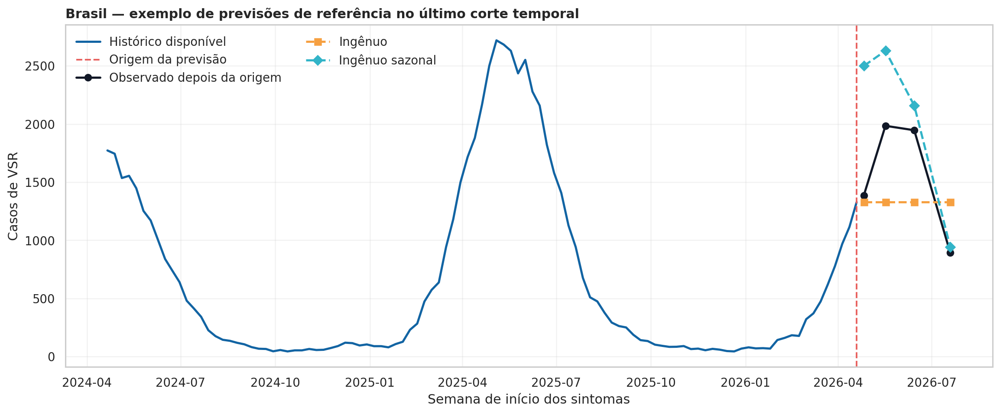
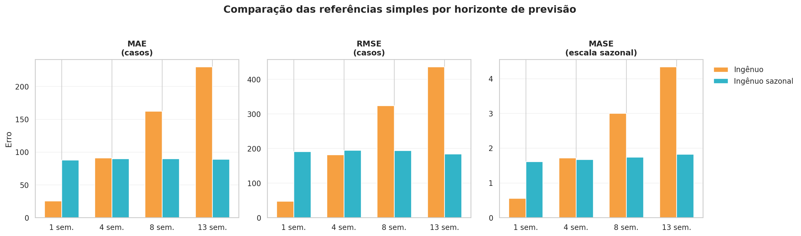
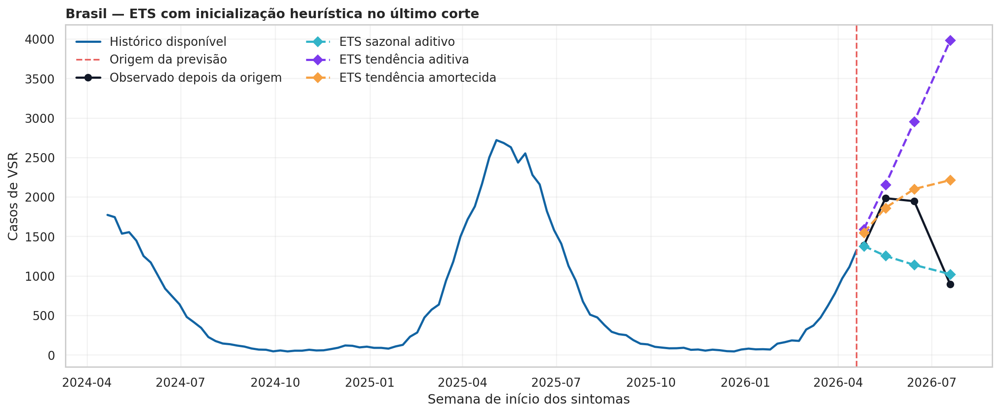

# Decisões da modelagem e avaliação de previsões — V2

## Objetivo desta etapa

Esta etapa transforma a base semanal madura e os achados da análise exploratória em previsões avaliadas fora da amostra. O objetivo não é escolher o modelo mais complexo, mas verificar se cada proposta reduz o erro em relação a referências simples, sem usar informação que ainda não existiria na data da previsão.

A avaliação começa por Brasil e regiões, que possuem séries densas e contínuas. As Unidades da Federação serão incorporadas posteriormente, respeitando sua intermitência e a estrutura hierárquica UF, região e Brasil.

## Entrada adotada

- Painel de origem: `painel_vsr_semanal_com_maturidade.parquet`.
- Recorte atual: Brasil e cinco regiões, usando somente semanas maduras segundo o limiar de 13 semanas definido na etapa de tratamento.
- Período disponível para modelagem: 30/12/2018 a 19/07/2026, com 395 semanas maduras por série.
- Calendário de avaliação: 58 origens temporais por série, quatro horizontes de previsão e treino expansivo, definido na Etapa 19.
- Unidade de previsão: número semanal de internações confirmadas por VSR em crianças menores de dois anos.

## Princípios adotados

1. Todos os modelos recebem o mesmo painel maduro e o mesmo calendário de validação.
2. Em cada origem temporal, o treino contém somente semanas até a origem; as semanas posteriores permanecem ocultas até a avaliação.
3. As métricas são calculadas separadamente para os horizontes de 1, 4, 8 e 13 semanas.
4. Referências simples são obrigatórias: maior complexidade só é útil se trouxer ganho preditivo mensurável.
5. MAE e RMSE, expressos em casos, são acompanhados por MASE para tornar comparáveis Brasil e regiões, que possuem escalas distintas.
6. Convergência numérica e plausibilidade epidemiológica são verificadas antes de interpretar o erro de um modelo.

## Etapa 20 — Preparação das entradas para previsão

Uma comparação só é justa quando todos os modelos recebem exatamente a mesma série, com a mesma definição de maturidade e os mesmos alvos de avaliação. Por isso, antes das previsões, carregamos o painel semanal com maturidade e o calendário de validação temporal, padronizamos as colunas e selecionamos Brasil, regiões e semanas maduras.

A primeira checagem identificou ausências de `casos_vsr` no painel completo. Elas não foram preenchidas por zero e nem removidas automaticamente. O diagnóstico mostrou uma ausência em linha não madura do Brasil, cinco em linhas não maduras das regiões e 27 em linhas não maduras das UFs. Não há ausências entre as semanas maduras. Os registros recentes permanecem preservados no painel original, mas não entram em treino ou avaliação histórica.

A entrada aprovada possui seis séries, 2.370 linhas e 395 semanas maduras por série. Não há duplicidades na chave `nível + unidade + data`, valores ausentes ou casos negativos nesse recorte. O Brasil possui 155.304 casos maduros, valor exatamente igual à soma das cinco regiões.

Também foram verificados os 1.392 alvos do calendário — seis séries, 58 origens e quatro horizontes. Todos foram encontrados no painel maduro, têm indicador de maturidade verdadeiro e conferem com o valor observado do calendário; a maior diferença encontrada foi zero.

**Decisão.** A entrada foi aprovada para referências e modelos posteriores. As UFs não foram excluídas: elas serão tratadas na etapa de previsão hierárquica, na qual sua intermitência e sua relação com as regiões poderão ser consideradas explicitamente.

## Etapa 21 — Referências simples de previsão

As referências simples definem o desempenho mínimo que um modelo mais complexo deve superar. Sem elas, um modelo poderia parecer bom apenas por produzir previsões visualmente sofisticadas.

A referência ingênua repete, em cada horizonte, o último número de casos conhecido na origem. Ela representa persistência de curtíssimo prazo. A referência ingênua sazonal utiliza o valor observado na mesma semana epidemiológica da temporada anterior. O script usou `ano_epi` e `semana_epi`, e não uma subtração fixa de 52 semanas, evitando desalinhamentos em anos com 53 semanas epidemiológicas.

A busca da referência sazonal foi restrita ao treino disponível em cada origem. A auditoria confirmou que nenhuma das 1.392 referências sazonais foi ausente ou posterior à respectiva data de origem. Foram geradas 2.784 previsões: 1.392 para o método ingênuo e 1.392 para o ingênuo sazonal, sem ausências ou duplicidades.

No último corte do Brasil, em 19/04/2026, o ingênuo repetiu 1.328 casos em todos os horizontes. O ingênuo sazonal recuperou o perfil de 2025 e previu 2.499, 2.629, 2.158 e 942 casos para 1, 4, 8 e 13 semanas. Os valores observados foram 1.386, 1.984, 1.946 e 892. Esse exemplo evidencia que uma única origem não escolhe um vencedor: a persistência ajuda no curtíssimo prazo, enquanto a sazonalidade pode ajudar quando o horizonte aumenta.

**Decisão.** As duas referências foram aprovadas como baselines oficiais do estudo.

## Etapa 22 — Métricas de erro das referências

MAE mostra o erro médio em número de casos. RMSE dá peso maior aos erros grandes, relevantes quando há risco de pressão hospitalar. MASE divide o erro por uma escala sazonal calculada dentro do treino e permite comparar séries de tamanhos diferentes.

Para cada série e origem, a escala MASE foi calculada somente com semanas disponíveis até aquela origem. Ela equivale à média dos erros absolutos entre semanas epidemiológicas equivalentes de anos consecutivos no treino. Foram calculadas 348 escalas, todas positivas e sem uso de informação futura.

| Horizonte | Melhor MAE | Melhor RMSE | Melhor MASE | Leitura |
|---|---:|---:|---:|---|
| 1 semana | Ingênuo: 25,6 | Ingênuo: 47,7 | Ingênuo: 0,55 | O último valor observado é a melhor referência imediata. |
| 4 semanas | Sazonal: 89,7 | Ingênuo: 181,9 | Sazonal: 1,67 | Resultado misto e diferença pequena de MAE. |
| 8 semanas | Sazonal: 89,8 | Sazonal: 193,8 | Sazonal: 1,74 | A informação sazonal torna-se decisiva. |
| 13 semanas | Sazonal: 89,1 | Sazonal: 184,0 | Sazonal: 1,82 | A referência sazonal domina a antecipação trimestral. |

O MAE ingênuo cresce de 25,6 casos em uma semana para 229,9 em 13 semanas. Já o MAE sazonal é alto em uma semana, 87,9, mas permanece próximo de 90 nos horizontes de 4, 8 e 13 semanas. A leitura é que repetir o último nível não acompanha uma onda inteira, enquanto a temporada anterior traz informação útil em previsões mais longas.

**Decisão.** Modelos posteriores precisam superar o ingênuo em uma semana e, sobretudo, desafiar o ingênuo sazonal em oito e 13 semanas.

## Etapa 23 — ETS inicial e auditoria de convergência

O primeiro teste de suavização exponencial comparou três especificações com sazonalidade anual de 52 semanas: ETS apenas sazonal aditivo, ETS com tendência aditiva e ETS com tendência aditiva amortecida. Em cada origem, a implementação inicial estimava os estados sazonais junto aos demais parâmetros.

A auditoria confirmou que não havia lacunas temporais: as seis séries tinham 395 semanas, de 30/12/2018 a 19/07/2026, sempre separadas por sete dias. Logo, uma eventual instabilidade não poderia ser atribuída a falhas de calendário ou ausências na entrada.

O resultado, porém, não foi suficientemente estável para avaliação de erro. Dos 348 ajustes esperados por especificação, o ETS sazonal convergiu em 318 (91,4%), o ETS com tendência aditiva em 87 (25,0%) e o ETS amortecido em 20 (5,7%). O segundo otimizador recuperou 72 ajustes, mas 619 continuaram sem convergir.

Essa diferença de cobertura impediria comparação justa: cada configuração seria avaliada em um conjunto diferente de origens. A causa mais provável é a estimação simultânea de 52 estados sazonais, nível e, em duas especificações, tendência, em cortes iniciais com somente 156 semanas de treino — aproximadamente três ciclos anuais.

**Decisão.** Nenhuma previsão da Etapa 23 entrou na comparação principal de erros. Os arquivos foram preservados como auditoria, e a Etapa 23B foi criada para verificar se a dificuldade era numérica, sem mudar série, calendário, horizonte ou estrutura conceitual dos modelos.

## Etapa 23B — ETS com inicialização sazonal heurística

Nesta etapa, mantivemos as mesmas seis séries, 58 origens, quatro horizontes e três estruturas ETS. A única alteração foi utilizar inicialização sazonal heurística. Em vez de estimar simultaneamente todos os estados iniciais da sazonalidade anual, o procedimento estabelece valores iniciais plausíveis com base na própria história observada e otimiza os parâmetros restantes.

O resultado isolou a origem do problema: os 1.044 ajustes previstos convergiram na primeira tentativa — 348 para cada configuração. Não houve necessidade de recorrer ao segundo otimizador. Cada modelo produziu as 1.392 previsões esperadas, permitindo a comparação direta com as baselines.

| Modelo | Ajustes convergentes | Previsões geradas | Previsões corrigidas para zero |
|---|---:|---:|---:|
| ETS sazonal aditivo | 348/348 | 1.392 | 41 (2,9%) |
| ETS tendência aditiva | 348/348 | 1.392 | 226 (16,2%) |
| ETS tendência amortecida | 348/348 | 1.392 | 99 (7,1%) |

As previsões negativas foram convertidas para zero apenas como proteção operacional, pois internações negativas não são possíveis. Essa correção também é um diagnóstico: a frequência elevada do ETS com tendência aditiva, sobretudo nos horizontes maiores, sinaliza que ele pode extrapolar a dinâmica recente de modo pouco plausível.

No último corte nacional, o ETS com tendência aditiva projetou 3.983 casos em 13 semanas, enquanto o observado foi 892. O ETS amortecido projetou 2.213 e o ETS sazonal, 1.022. O gráfico é uma ilustração útil de comportamento, mas não foi usado isoladamente para escolher modelos: a decisão depende da avaliação em todos os cortes.

**Decisão.** As três configurações foram aprovadas apenas para a etapa de métricas, pois cumpriram o requisito de cobertura idêntica. Elas ainda não foram declaradas modelos finais.

## Etapa 24 — Comparação entre baselines e ETS

As duas baselines e os três ETS heurísticos foram avaliados nos mesmos 348 cortes, seis séries, quatro horizontes e valores observados. Cada modelo possui 1.392 previsões; portanto, diferenças de desempenho não decorrem de cobertura ou calendário distintos.

As métricas foram calculadas usando a previsão operacional não negativa. O diagnóstico das correções foi preservado separadamente para evitar que bons resultados médios escondessem previsões epidemiologicamente impossíveis.

| Horizonte | Melhor modelo por MASE | MASE | MAE | Interpretação |
|---|---|---:|---:|---|
| 1 semana | ETS tendência amortecida | 0,507 | 21,6 | A informação recente contribui para o curtíssimo prazo. |
| 4 semanas | ETS tendência amortecida | 1,311 | 65,5 | O modelo reduz o erro em relação às baselines no curto prazo. |
| 8 semanas | Ingênuo sazonal | 1,741 | 89,8 | A temporada anterior é mais informativa que a extrapolação recente. |
| 13 semanas | Ingênuo sazonal | 1,823 | 89,1 | A sazonalidade anual domina a antecipação mais longa. |

Em uma semana, o ETS amortecido reduziu o MASE de 0,554 do ingênuo para 0,507, um ganho de 8,5%. Em quatro semanas, reduziu o melhor MASE de baseline, 1,670, para 1,311, um ganho de 21,5%.

Em oito e 13 semanas, a situação se inverteu. O ingênuo sazonal obteve MASE de 1,741 e 1,823, enquanto o melhor ETS ficou em 2,628 e 3,660, respectivamente. Assim, não há um vencedor único para todos os horizontes: a previsão de curto prazo favorece o ETS amortecido; a previsão de médio prazo favorece a referência sazonal.

A leitura por série confirma o padrão. O ETS amortecido venceu Brasil, Nordeste, Sudeste e Sul em uma semana; em quatro semanas venceu cinco das seis séries, com exceção do Centro-Oeste. Em oito e 13 semanas, o ingênuo sazonal venceu as seis séries.

O ETS com tendência aditiva não venceu nenhum horizonte agregado. Além disso, exigiu correção para zero em 23,0% das previsões de oito semanas e 24,7% das previsões de 13 semanas. Ele não seguirá como candidato principal. O ETS sazonal aditivo foi estável, mas não venceu no agregado; será mantido apenas como referência de sensibilidade. O ETS amortecido permanecerá como candidato de curto prazo, com a ressalva de 6,0% de correções no horizonte 4 e 10,3% no horizonte 13.

**Decisão.** A seleção passa a ser dependente do horizonte: ETS amortecido é a referência a superar em 1 e 4 semanas; ingênuo sazonal é a referência a superar em 8 e 13 semanas. O próximo modelo será SARIMA, avaliado no mesmo protocolo, antes de avançarmos à previsão hierárquica.

## Conclusões provisórias

1. Há ganho preditivo de curto prazo ao combinar nível recente, tendência amortecida e sazonalidade.
2. A sazonalidade anual é indispensável para previsões de dois e três meses.
3. A tendência aditiva simples é instável do ponto de vista epidemiológico: além de piorar os erros longos, produz muitas previsões negativas antes do truncamento.
4. Convergência numérica é necessária, mas não suficiente. Um modelo também precisa gerar previsões plausíveis e reduzir o erro fora da amostra.
5. A escolha final pode ser horizonte-dependente, desde que essa regra seja definida com base na validação temporal e seja útil para planejamento hospitalar.

## Próximos passos da modelagem

1. Ajustar modelos SARIMA para Brasil e regiões usando o mesmo painel, calendário e horizontes.
2. Comparar SARIMA com ETS amortecido, ETS sazonal e as duas baselines, por horizonte e por série.
3. Manter somente os modelos que acrescentarem ganho mensurável, estabilidade e plausibilidade.
4. Estender os candidatos selecionados às UFs.
5. Gerar previsões-base em UF, região e Brasil e aplicar reconciliação hierárquica — bottom-up, top-down e MinT — para garantir coerência entre os níveis geográficos.

## Arquivos de evidência

- Notebook parcial: `notebook_parcial_modelagem_avaliacao/Modelagem_Avaliacao_3_Etapa_v2.ipynb`.
- Entrada aprovada: `painel_modelagem_brasil_regioes.parquet`, `resumo_entrada_modelagem.csv`, `perfil_campos_entrada_modelagem.csv` e `validacao_calendario_entrada_modelagem.csv`.
- Baselines: `previsoes_referencias_simples.csv`, `auditoria_referencias_simples.csv`, `resumo_disponibilidade_referencias.csv` e `exemplo_previsao_referencias_brasil.png`.
- Métricas das baselines: `escalas_mase_por_origem.csv`, `erros_individuais_referencias.csv`, `metricas_agregadas_referencias.csv`, `ranking_referencias_por_horizonte.csv` e `comparacao_metricas_referencias.png`.
- ETS inicial: `auditoria_ets.csv`, `auditoria_tentativas_ets.csv`, `resumo_convergencia_ets.csv`, `resumo_disponibilidade_ets.csv` e `exemplo_previsoes_ets_brasil.png`.
- ETS heurístico: `auditoria_ets_heuristico.csv`, `auditoria_tentativas_ets_heuristico.csv`, `resumo_convergencia_ets_heuristico.csv`, `resumo_disponibilidade_ets_heuristico.csv`, `previsoes_ets_heuristico.csv` e `exemplo_previsoes_ets_heuristico_brasil.png`.
- Comparação da Etapa 24: `controle_modelos_comparados.csv`, `erros_individuais_baselines_ets.csv`, `metricas_agregadas_baselines_ets.csv`, `ranking_modelos_baselines_ets.csv`, `diagnostico_correcoes_nao_negativas_ets.csv`, `comparacao_baselines_ets_metricas.png` e o arquivo de métricas por série da etapa 24.
